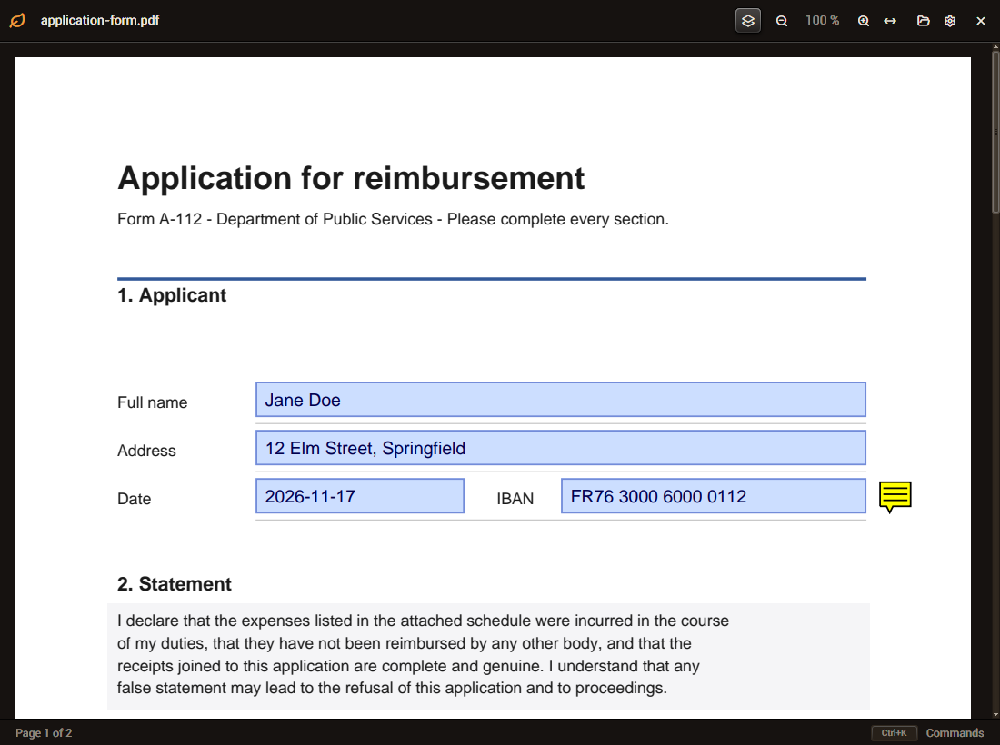

<h1 align="center">feuille</h1>

<b>Open a PDF at once, arrange its pages, change its words.</b>

feuille opens a PDF without the signatures, annotations and form fields that block other readers: only the pages' own
content is drawn, and nothing on the page takes the keyboard or asks for input. Ctrl+L draws the form layer when you
want it. A protected PDF asks for its password in the window.

| The form layer, on demand (Ctrl+L) | Every command at Ctrl+K |
|---|---|
|  |  |
| **The settings (Ctrl+,)** | **Light** |
|  |  |

Only the pages near the view are drawn, on a thread of their own: a long document scrolls as a short one, and the window
never waits. Turning, adding, removing and reordering pages, and changing a text block's words, come next
([ROADMAP.md](ROADMAP.md)). One version, everything in it; a licence only says you support it.

One small native program, written in [Odin](https://odin-lang.org) on
[gui_toolkit](https://github.com/sachahjkl/gui_toolkit), with Chromium's PDF engine,
[PDFium](https://pdfium.googlesource.com/pdfium/). Linux first; Windows later.

## Install

- Nix: `nix run github:sachahjkl/feuille -- file.pdf`, or `nix profile add github:sachahjkl/feuille`.
- The archive of a [release](https://github.com/sachahjkl/feuille/releases): it needs `libpdfium.so` of
  [pdfium-binaries](https://github.com/bblanchon/pdfium-binaries) on the library path.

[docs/usage.md](docs/usage.md) says how to use it, [docs/configuration.md](docs/configuration.md) its settings,
[docs/development.md](docs/development.md) how to build it, [src/md](src/md/README.md) how it is designed.

## License

MIT. PDFium is under the BSD licence; the Lucide icons under the ISC licence.
