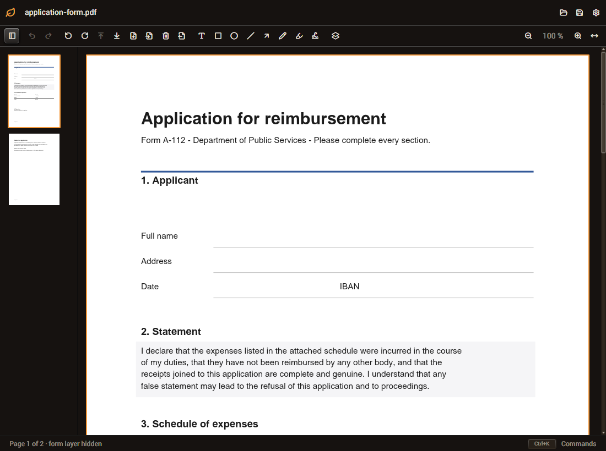
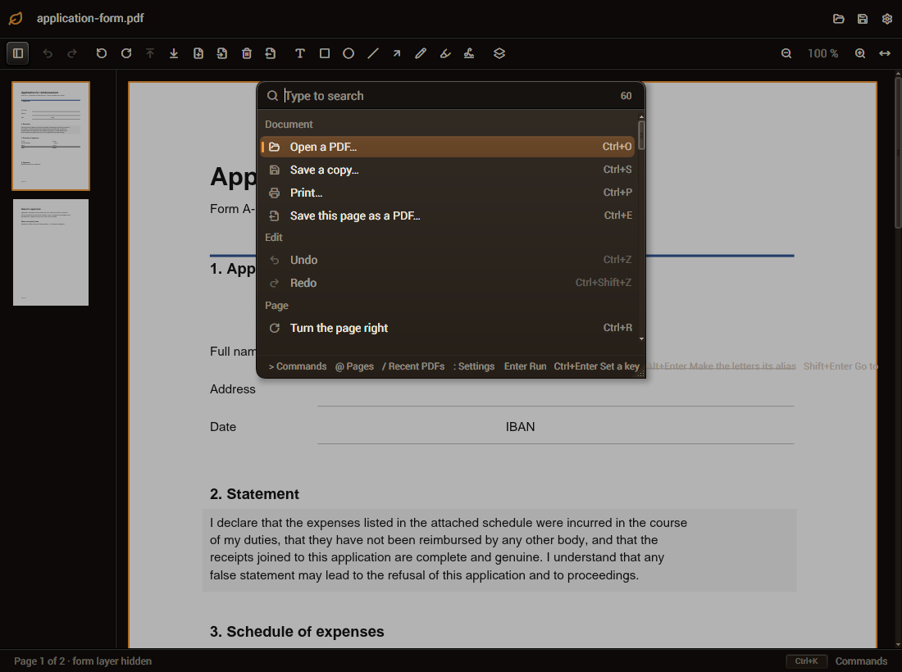
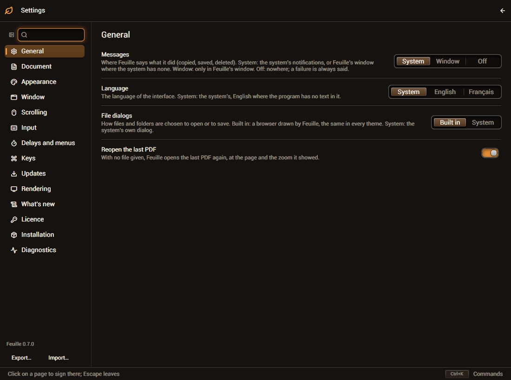
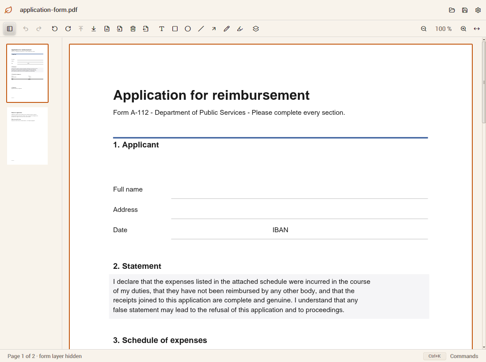

<p align="center"></p>

<h1 align="center">feuille</h1>

<p align="center"><b>Open a PDF at once, arrange its pages, change its words.</b></p>

<p align="center">
<a href="https://github.com/sachahjkl/feuille/actions/workflows/ci.yml"></a>
<a href="https://feuille.froment.software/"></a>
<a href="LICENSE"></a>
</p>

feuille opens a PDF without the signatures, annotations and form fields that block other readers: only the pages' own
content is drawn, and nothing on the page takes the keyboard or asks for input. Ctrl+L draws the form layer when you
want it. A protected PDF asks for its password in the window.

<p align="center"></p>

| The form layer, on demand (Ctrl+L) | Every command at Ctrl+K |
|---|---|
|  |  |
| **The settings (Ctrl+,)** | **Light** |
|  |  |

One small native program, written in [Odin](https://odin-lang.org) on
[gui_toolkit](https://github.com/sachahjkl/gui_toolkit), with Chromium's PDF engine,
[PDFium](https://pdfium.googlesource.com/pdfium/). Windows and Linux. Its site:
[feuille.froment.software](https://feuille.froment.software/).

## Features

- **Nothing blocks the page**: the signatures, annotations and form fields stay hidden unless you ask (Ctrl+L).
- **Arrange the pages**: turn, add, remove, reorder them (drag their thumbnails), add the pages of another PDF, take one
  out as its own PDF. Every edit undoes and redoes; a copy is saved, the original replaced only after a question.
- **Change the words** of a text block (double click, or F2 then a click).
- **Fast**: only the pages near the view are drawn, on a thread of their own. A long document scrolls as a short one,
  and the window never waits.
- **It remembers**: each PDF opens again at its page and its zoom; the last one comes back at the start; the recent
  ones are a key away (Ctrl+Shift+O).
- **Command palette** (Ctrl+K): every command and setting found by typing; `@` a page, `/` a recent PDF.
- **Context menus**: a right click on a page or a thumbnail for its edits, its path, its folder, Open with.
- **One window per person**: `feuille file.pdf` while feuille runs opens the file there.
- **Installed for you** (`feuille --install`, or the Setup on Windows): in the applications menu, on the PATH, updated
  by itself.
- **Settings** (Ctrl+,): a page per subject, searched, the themes as cards.

One version, everything in it; a licence only says you support it. What comes next is in [ROADMAP.md](ROADMAP.md).

## Keys

| Key | |
|---|---|
| Ctrl+O, Ctrl+Shift+O | open a PDF; a recent one |
| Ctrl+S, Ctrl+E | save a copy; save the page alone |
| Page Up, Page Down, Ctrl+Home, Ctrl+End, Ctrl+G | the previous, next, first, last page; a page by its number |
| Ctrl+wheel | zoom the pages |
| Ctrl+R, Ctrl+Shift+R | turn the page right, left |
| Alt+Up, Alt+Down | move the page |
| Delete, Ctrl+Shift+N, Ctrl+I | remove the page; add a blank one; add the pages of a PDF |
| Ctrl+Z, Ctrl+Shift+Z | undo, redo |
| F2 | edit a text block |
| Ctrl+L, Ctrl+B | the form layer; the thumbnails |
| Ctrl+Shift+C | copy the path |
| Ctrl+N, F11 | a new window; full screen |
| Ctrl+K, F1 | the command palette; every key |
| Ctrl+, | settings |

## Install

- Windows 10 and 11, Linux: the archive of a [release](https://github.com/sachahjkl/feuille/releases), PDFium beside
  the program. Unpack it and start it; `feuille --install` installs it for you ([docs/desktop.md](docs/desktop.md)).
- Nix: `nix run github:sachahjkl/feuille -- file.pdf`, or `nix profile add github:sachahjkl/feuille`.

## Documentation

- [Usage](docs/usage.md): reading, arranging, changing the words.
- [Configuration](docs/configuration.md): every preference.
- [The desktop](docs/desktop.md): the install, the menu, one window.
- [Architecture](docs/architecture.md): the files, the threads and the tests.
- [Intent](src/md/README.md): why the code has its shape, the decisions and the refused alternatives.
- [Development](docs/development.md): building, testing, `feuilletool`.

## Build

```sh
git clone --recurse-submodules https://github.com/sachahjkl/feuille && cd feuille
nix develop
./build.sh release      # build/feuille
```

Every step of the project is a command of `tools/feuilletool`: see [docs/development.md](docs/development.md).

## Licence

MIT, see [LICENSE](LICENSE). PDFium is under the BSD licence; the Lucide icons under the ISC licence.
THIRD-PARTY-NOTICES lists every work the program holds.
